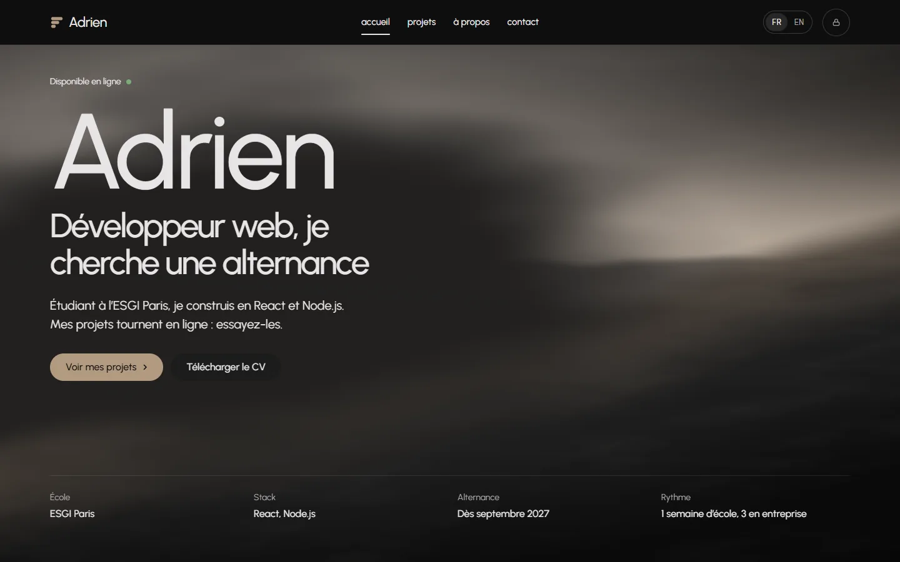
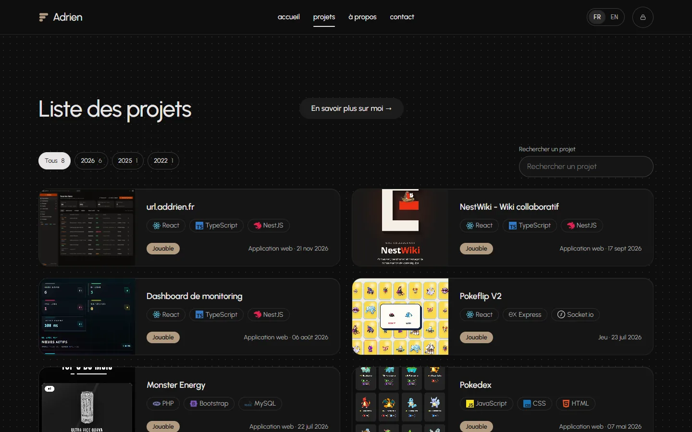
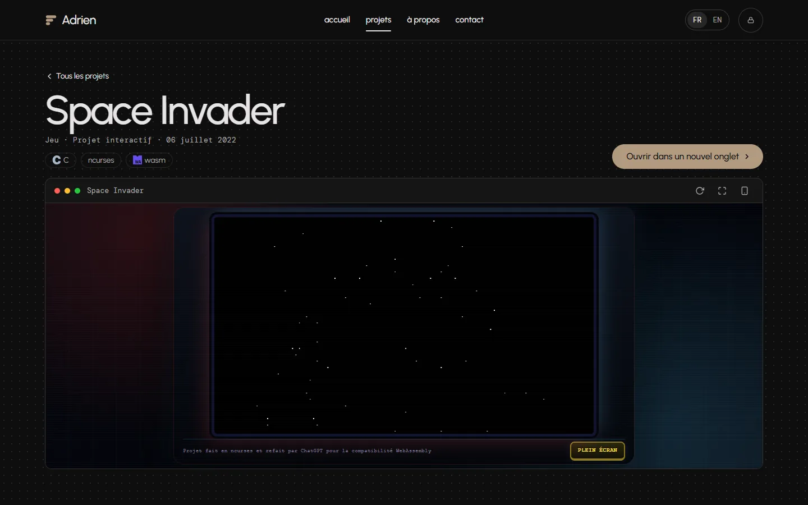
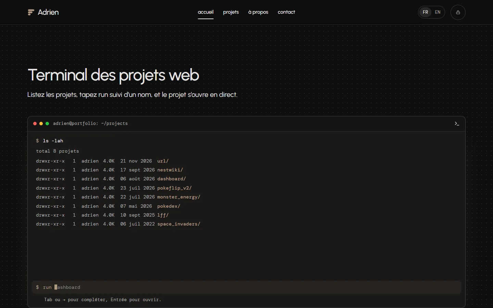
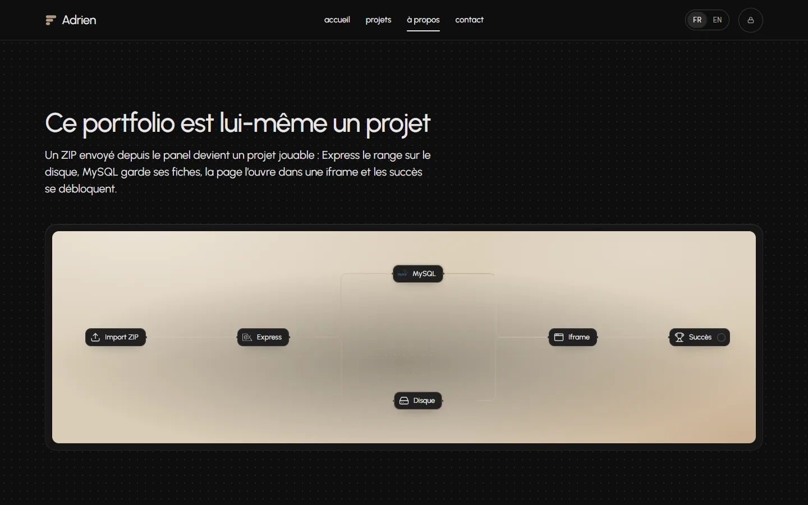
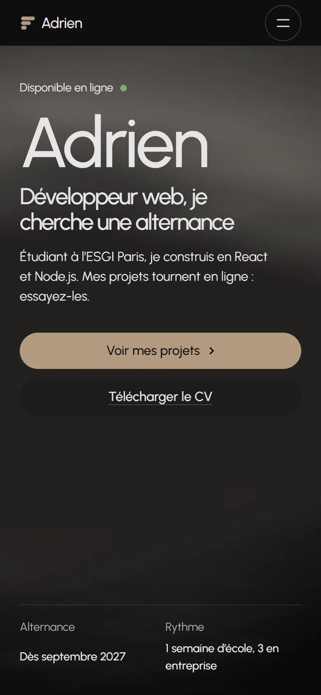
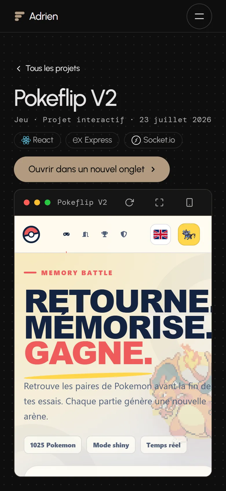
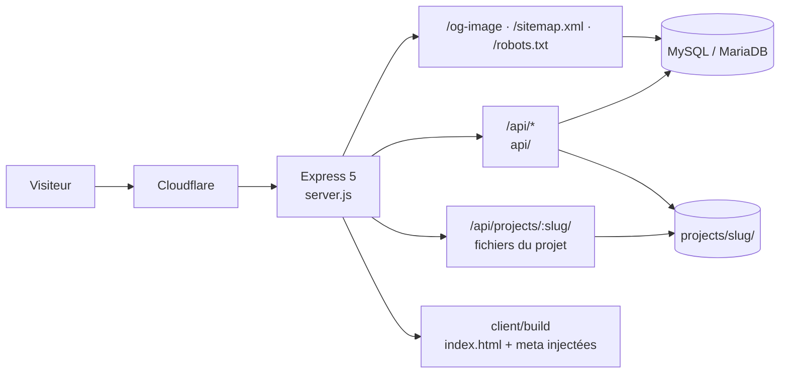

# Portfolio dynamique

Portfolio de développeur où chaque projet se teste en direct dans le navigateur, sans rien installer. Les projets sont des applications web statiques (HTML/CSS/JS, builds React, jeux…) envoyées en ZIP depuis un panel d'administration, puis servies dans une `<iframe>`.

En ligne sur **[addrien.fr](https://addrien.fr)**.



- **Frontend** : React 19 + Vite, `react-router`, `i18next` (FR/EN)
- **Backend** : Node.js 22 + Express 5, un seul serveur pour l'API, les projets et le site
- **Base de données** : MySQL / MariaDB (`mysql2`), sessions stockées en base
- **Rendu d'images** : `node-canvas` pour les aperçus Open Graph générés à la volée
- **Livraison** : image Docker construite par GitHub Actions et publiée sur GHCR

---

## Fonctionnalités

### Site public

| Route | Contenu |
| --- | --- |
| `/` | Présentation, sélection de projets mis en avant, terminal interactif listant les derniers projets (la commande `run <projet>` l'ouvre), contact et CV |
| `/projects` | Liste paginée des projets publiés (10 par page), filtre par année, recherche côté serveur (nom, description, technologie, type) |
| `/projects/:project` | Le projet en direct dans une iframe, avec sa description, sa stack (icônes automatiques), son type et ses contributeurs GitHub |
| `/about` | Parcours, boîte à outils, schéma animé de l'architecture du portfolio, liens et contributions GitHub en serpent |
| `/achievements` | Les succès débloqués par le visiteur (easter eggs) |
| `/mentions-legales` | Mentions légales et confidentialité |

Le site est bilingue (détection automatique de la langue, bascule manuelle) et le CV téléchargé suit la langue choisie.

<table>
  <tr>
    <td width="50%"><br><sub><b>/projects</b> : filtre par année, recherche, stack et type</sub></td>
    <td width="50%"><br><sub><b>/projects/:project</b> : le projet tourne dans la page</sub></td>
  </tr>
  <tr>
    <td width="50%"><br><sub>Le terminal de l'accueil : <code>run &lt;projet&gt;</code> ouvre un projet</sub></td>
    <td width="50%"><br><sub><b>/about</b> : le schéma animé de l'architecture</sub></td>
  </tr>
</table>

Le site est pensé aussi pour mobile :

<p>
  
  &nbsp;
  
</p>

### Panel d'administration (`/panel`)

Protégé par mot de passe (`/panel/login`). Pour chaque projet :

- ajout avec nom, descriptions FR/EN, ZIP, vignette, stack, type et contributeurs ;
- modification de tous les champs, avec remplacement optionnel du ZIP ou de la vignette ;
- publication ou masquage : un projet non publié reste dans le panel mais disparaît du site, du sitemap et de l'API publique ;
- aperçu en direct (iframe isolée, y compris pour un projet non publié) ;
- téléchargement des fichiers du projet en ZIP ;
- suppression.

### Partage et référencement

Le serveur injecte dans `index.html`, pour chaque route, le titre, la description, l'URL canonique, la directive `robots` et l'image Open Graph. Une carte Discord (Components V2) est aussi ajoutée pour les liens collés dans Discord.

Les images Open Graph sont rendues en PNG à la demande : `/og-image` pour le portfolio, `/og-image/:slug` pour un projet. `robots.txt` et `sitemap.xml` sont générés à partir des projets publiés.

### Achievements

Une vingtaine de succès se débloquent en explorant le site : pages visitées, projets ouverts, temps passé, raccourcis clavier, visites répétées, arrivée depuis LinkedIn ou GitHub… La progression est stockée dans le `localStorage` du visiteur, et une popup s'affiche à chaque déblocage.

Un projet embarqué peut lui-même débloquer un succès (voir [Débloquer un succès depuis un projet](#débloquer-un-succès-depuis-un-projet)).

---

## Architecture



### Cycle d'une requête (`server.js`)

1. **Limiteur global** (`middleware/rateLimit.js`) : 100 requêtes par minute et par IP (`cf-connecting-ip`). Les fichiers statiques des projets ne sont pas comptés.
2. **Session** `express-session` stockée en MySQL (`express-mysql-session`, table créée automatiquement, expiration 24 h).
3. `cors`, `compression`, `express.json`.
4. `/robots.txt` généré pour le domaine courant.
5. Routeur `api/index.js` : API, sitemap, images Open Graph.
6. 404 JSON pour toute route `/api/*` inconnue.
7. Fichiers statiques de `client/build`.
8. Rendu final : lecture de `client/build/index.html`, choix des meta (page statique, projet trouvé par slug, panel ou 404), remplacement des marqueurs `__TITLE__`, `__DESCRIPTION__`, `__IMAGE__`, `__URL__`, `__ORIGIN__`, `__ROBOTS__` et `__DISCORD_EMBED__`.

Au démarrage, le serveur refuse de se lancer sans `PANEL_PASSWORD` ni `SESSION_SECRET`, attend que le store de sessions soit prêt, puis ajoute les colonnes manquantes à la table `projects` (`services/projectSchema.js`).

### URL selon le domaine (`config.js`)

`getSiteUrl(req)` calcule l'origine canonique à partir de `x-forwarded-host` ou `host`. Si le domaine fait partie de `SITE_HOSTNAMES`, il est utilisé tel quel (en `https`, sauf `localhost`). Sinon, on retombe sur `SITE_URL`. Les canonicales, les images Open Graph, `robots.txt` et le sitemap s'adaptent donc au domaine consulté.

### Modules backend

| Module | Rôle |
| --- | --- |
| `api/projects.js` | Liste publique, métadonnées, vignette et fichiers d'un projet publié |
| `api/login.js` | Connexion, déconnexion, état de la session |
| `api/panel.js` | Liste complète pour le panel, aperçu signé, téléchargement ZIP |
| `api/add.js`, `api/modify.js`, `api/delete.js` | CRUD des projets (authentifié) |
| `api/og-image.js`, `utils/og.js` | Rendu des images Open Graph avec `node-canvas` |
| `api/sitemap.js` | Sitemap XML des pages et projets publiés |
| `api/techIcons.js`, `utils/techIcons.js` | Icône de marque d'une technologie (Simple Icons) |
| `services/projectUpload.js` | Lecture du formulaire multipart (`busboy`) |
| `services/projectArchive.js` | Extraction sécurisée du ZIP, installation, remplacement et suppression avec retour arrière |
| `services/projectListing.js` | Pagination, filtre par année et recherche |
| `services/projectSchema.js` | Migrations idempotentes au démarrage |
| `utils/functions.js` | Accès MySQL partagé (`getPool`, `getPublishedProjectBySlug`) |
| `utils/previewToken.js` | Jetons HMAC des aperçus du panel |
| `utils/discordEmbed.js` | Carte Discord injectée dans la page |
| `middleware/auth.js` | Renvoie un 401 JSON si la session n'est pas authentifiée |

### Frontend (`client/src/`)

- `App.jsx` et `routes/AppRoutes.jsx` : routes chargées à la demande (`lazy`), panel protégé par l'état de session.
- `pages/` : une page par route.
- `components/` : cartes, formulaires du panel, aperçus, terminal, `Seo.jsx`/`RouteSeo.jsx` pour les meta côté client ; `components/ui/` regroupe les briques de base (`Button`, `Card`, `Section`, `AppFrame`).
- `hooks/` : logique de données séparée du rendu (`usePanelAuth`, `usePanelProjects`, `useProjectDetails`, `useProjectFrame`, `useHeroEffect`…).
- `utils/achievements/` : système de succès (`config`, `init`, `unlocks`, `visitTracker`, `projectTracker`, `discoveryTracker`, `popup`), réexporté par `utils/achievements.js`.
- `locales/{fr,en}.json` : traductions.
- `client/public/assets/` : feuilles de style partagées, effet de fond animé (`effects/`) et moteur du schéma de la page À propos (`diagrams/`).

---

## Démarrage rapide

### Prérequis

- Node.js 22 et npm
- Un serveur MySQL ou MariaDB
- `canvas` s'installe avec des binaires précompilés sur les plateformes courantes. À défaut, il faut les bibliothèques Cairo, Pango, libjpeg et giflib (voir le `Dockerfile` pour la liste Debian).

### Installation

```bash
git clone https://github.com/FireDroX/dynamic-portfolio.git
cd dynamic-portfolio

npm install
cd client && npm install && cd ..

cp .env.example .env   # puis remplacer les valeurs d'exemple
```

Créer la base et la table `projects` (voir [Base de données](#base-de-données)).

### Développement

Deux terminaux :

```bash
# Backend, sur :3000
npm run dev
```

```bash
# Frontend, sur :5173
cd client
npm start
```

Ouvrir `http://localhost:5173`. Vite transmet `/api`, `/og-image` et `/sitemap.xml` au backend.

> Le backend rend les pages à partir de `client/build/index.html`. Sans build du client, seules l'API et les routes générées répondent sur `:3000`.

### Production locale

```bash
cd client && npm run build && cd ..
npm start
```

Le site complet est alors servi sur `http://localhost:3000`.

---

## Configuration

Toutes les variables se trouvent dans `.env` (modèle : `.env.example`).

| Variable | Rôle |
| --- | --- |
| `NODE_ENV` | `production` active `trust proxy` et les cookies `secure` |
| `PORT` | Port d'écoute (défaut `3000`) |
| `SITE_URL` | Origine de repli pour les domaines non reconnus (défaut `https://addrien.fr`) |
| `SITE_HOSTNAMES` | Domaines acceptés, séparés par des virgules (défaut `addrien.fr,localhost,127.0.0.1`) |
| `PANEL_PASSWORD` | Mot de passe du panel, **obligatoire** |
| `SESSION_SECRET` | Secret des sessions et des jetons d'aperçu, **obligatoire**, à générer longuement et aléatoirement |
| `SQL_SERVER`, `SQL_PORT` | Hôte et port MySQL |
| `SQL_USER`, `SQL_PASSWORD` | Identifiants MySQL |
| `SQL_DBNAME` | Nom de la base |

---

## Base de données

Le serveur crée seul la table des sessions. La table `projects` doit exister avec ses colonnes de base ; les colonnes plus récentes sont ajoutées au démarrage si elles manquent.

```sql
CREATE TABLE projects (
  id            INT AUTO_INCREMENT PRIMARY KEY,
  name          VARCHAR(255) NOT NULL,
  descriptionFr TEXT         NOT NULL,
  descriptionEn TEXT         NOT NULL,
  fileName      VARCHAR(255) NOT NULL UNIQUE,
  image         LONGTEXT     NULL,
  createdAt     DATETIME     NOT NULL DEFAULT CURRENT_TIMESTAMP
);
```

| Colonne | Contenu |
| --- | --- |
| `id` | Identifiant |
| `name` | Nom affiché (plusieurs projets peuvent porter le même) |
| `descriptionFr`, `descriptionEn` | Descriptions par langue |
| `fileName` | Slug unique, tiré du nom du ZIP, utilisé dans les URL et comme dossier dans `projects/` |
| `image` | Vignette en data URL base64 (PNG, JPEG, GIF ou WebP) |
| `createdAt` | Date de création, utilisée pour le tri et le filtre par année |
| `contributors` | *Ajoutée au démarrage.* Logins GitHub en JSON (20 au plus) |
| `stack` | *Ajoutée au démarrage.* Technologies en JSON (12 au plus, 30 caractères chacune) |
| `type` | *Ajoutée au démarrage.* `game`, `webapp`, `tool` ou `NULL` |
| `published` | *Ajoutée au démarrage.* `1` visible sur le site (défaut), `0` masqué |

Un projet non publié reste modifiable dans le panel, mais il disparaît de `/projects`, du terminal de l'accueil, du sitemap et des images Open Graph ; ses URL publiques répondent 404.

---

## Ajouter un projet

Depuis le panel, un projet se compose de :

- **un ZIP** (100 Mo au plus) avec un `index.html` à sa racine. Le nom du fichier devient le slug : `mon-jeu.zip` est servi sur `/api/projects/mon-jeu/` et présenté sur `/projects/mon-jeu`. Les chemins absolus, les `..` et les liens symboliques sont refusés, et un slug déjà pris renvoie une erreur 409 ;
- un nom et des descriptions FR/EN (obligatoires) ;
- une vignette, une stack, un type, des contributeurs et un statut de publication (facultatifs).

Les fichiers sont extraits dans `projects/<slug>/` : ce dossier n'est pas versionné et correspond au volume `/app/projects` dans Docker. Les liens relatifs du projet fonctionnent tels quels puisqu'il est servi sous son propre chemin.

### Débloquer un succès depuis un projet

Les projets publics sont embarqués dans une iframe non isolée, sur la même origine que le site, pour pouvoir utiliser cookies et stockage. Un projet peut débloquer un succès du portfolio en envoyant un message à la page parente :

```js
window.parent.postMessage({ type: "portfolio:space-invader" }, "*");
```

Le type vaut `portfolio:` suivi du nom du succès en minuscules, espaces remplacés par des tirets (liste dans `client/src/utils/achievements.json`). Seuls les messages d'une iframe directe de la page sont acceptés, et les événements internes (remise à zéro, etc.) ne peuvent pas être déclenchés ainsi.

---

## API

Toutes les réponses sont en JSON sauf mention contraire. « Auth » signifie qu'une session de panel est requise (sinon 401).

### Public

| Méthode | Route | Description |
| --- | --- | --- |
| `GET` | `/api/projects?page=1&size=10&year=2025&q=texte` | Projets publiés : `{ items, page, size, total, totalPages, years }`, `size` limité à 100 |
| `GET` | `/api/projects/:project/meta` | Métadonnées d'un projet publié |
| `GET` | `/api/projects/:project/image` | Vignette (image binaire, mise en cache 24 h) |
| `GET` | `/api/projects/:project/…` | Fichiers du projet (`index.html` à la racine) |
| `GET` | `/api/tech-icons?name=React` | Icône Simple Icons `{ title, hex, path }` ou 404 |
| `GET` | `/og-image`, `/og-image/:slug` | Image Open Graph en PNG (10 requêtes par minute et par IP) |
| `GET` | `/sitemap.xml`, `/robots.txt` | Générés pour le domaine courant |

### Authentification

| Méthode | Route | Description |
| --- | --- | --- |
| `POST` | `/api/panel/login` | `{ password }`. Limité à 10 échecs par 15 min et par IP |
| `POST` | `/api/panel/login/logout` | Détruit la session |
| `GET` | `/api/panel/login/me` | `{ authenticated }` |

### Panel

| Méthode | Route | Description |
| --- | --- | --- |
| `GET` | `/api/panel` | Auth. Tous les projets, publiés ou non, avec leur URL d'aperçu |
| `POST` | `/api/panel/add` | Auth. `multipart/form-data` : `name`, `descriptionFr`, `descriptionEn`, `zip`, et en option `image`, `stack`, `contributors`, `type`, `published` |
| `POST` | `/api/panel/modify` | Auth. Mêmes champs plus `originalFileName` ; `zip` et `image` facultatifs, un champ absent garde sa valeur |
| `POST` | `/api/panel/delete` | Auth. `{ fileName }` : supprime la ligne puis les fichiers |
| `GET` | `/api/panel/download/:project` | Auth. Fichiers du projet en ZIP |
| `GET` | `/api/panel/preview/:token/:project/…` | Aperçu d'un projet, autorisé par un jeton signé valable 24 h |

---

## Sécurité

- Le mot de passe du panel est comparé en temps constant ; la session est régénérée à la connexion.
- Cookies `httpOnly`, `sameSite=lax`, `secure` en production.
- Les ZIP sont vérifiés avant extraction (chemins, liens symboliques, `index.html`), et un remplacement ou une suppression qui échoue est annulé.
- L'aperçu du panel tourne dans une iframe `sandbox` sans `allow-same-origin` : le code d'un projet ne s'exécute jamais avec la session d'administration. Ses fichiers sont donc chargés via un jeton HMAC dans l'URL plutôt que par le cookie.
- `robots.txt` exclut `/api/` et `/panel/` ; les pages du panel et les 404 sont en `noindex`.
- Limitation de débit globale, sur la connexion et sur le rendu des images Open Graph.

---

## Tests et qualité

```bash
npm test                  # backend : Vitest, tests dans test/
cd client && npm test     # frontend : Vitest + Testing Library, tests à côté des fichiers (*.test.jsx)
cd client && npm run lint # ESLint
```

---

## Docker et déploiement

Le `Dockerfile` à la racine construit une seule image en trois étapes : build du client Vite, dépendances backend (compilation de `canvas`), puis image d'exécution `node:22-bookworm-slim` qui tourne en utilisateur `node`, expose le port `3000` et déclare le volume `/app/projects`.

```bash
docker build -t portfolio .
docker run --env-file .env -p 3000:3000 -v portfolio_projects:/app/projects portfolio
```

### Intégration continue

- **CI** (`.github/workflows/ci.yml`), sur chaque PR et chaque push vers `main` ou `dev` : lint du client, tests backend, tests frontend. Sur `main`, l'image est ensuite construite et publiée sur `ghcr.io/firedrox/portfolio-image` (tags `latest` et SHA).
- **Deploy** (`.github/workflows/deploy.yml`), après une CI réussie sur `main` : connexion SSH au serveur à travers un tunnel Cloudflare, `git pull`, puis lancement de `build.sh`.
- **Dependabot** suit les dépendances npm (racine et `client/`), les versions des actions GitHub et l'image de base Docker.

`build.sh` est le script de déploiement de l'auteur : il récupère l'image GHCR, recrée le conteneur `portfolio` (port `127.0.0.1:3333`, réseau dédié, réseau interne partagé avec MariaDB, volume des projets) et nettoie les anciennes images. Il est à adapter à votre propre infrastructure.

### Image Open Graph statique

`client/public/preview.png` sert d'image de repli quand le rendu dynamique échoue. Pour la régénérer à partir des projets en base :

```bash
npm run generate:og
```

---

## Structure

```
.
├── server.js              Point d'entrée Express
├── config.js              URL canonique selon le domaine
├── db.js                  Pool MySQL
├── api/                   Routes HTTP
├── middleware/            Authentification et limitation de débit
├── services/              Upload, archives, listing, migrations
├── utils/                 Open Graph, images, validation, jetons, carte Discord
├── scripts/               Génération de l'image Open Graph statique
├── fonts/                 Polices utilisées par node-canvas
├── test/                  Tests backend
├── docs/screenshots/      Captures du README
├── projects/              Projets installés (non versionné)
├── client/
│   ├── public/            Favicon, manifest, robots, assets partagés
│   └── src/
│       ├── pages/         Une page par route
│       ├── components/    Composants et briques UI
│       ├── hooks/         Logique de données
│       ├── routes/        Déclaration des routes
│       ├── utils/         API, achievements, stack, pagination…
│       ├── locales/       Traductions FR/EN
│       └── styles/        Tokens et styles de base
├── Dockerfile
└── build.sh               Déploiement personnel (à adapter)
```

---

## Contribuer

1. Forker le dépôt.
2. Créer une branche depuis `dev`.
3. Vérifier `npm test` à la racine, puis `npm test` et `npm run lint` dans `client/`.
4. Ouvrir une pull request vers `dev`.

## Auteur

Développé par [FireDroX](https://github.com/FireDroX). Pour soutenir le projet : [Ko-fi](https://ko-fi.com/addrien).

## Licence

Distribué sous licence MIT. Voir [LICENSE](./LICENSE).
